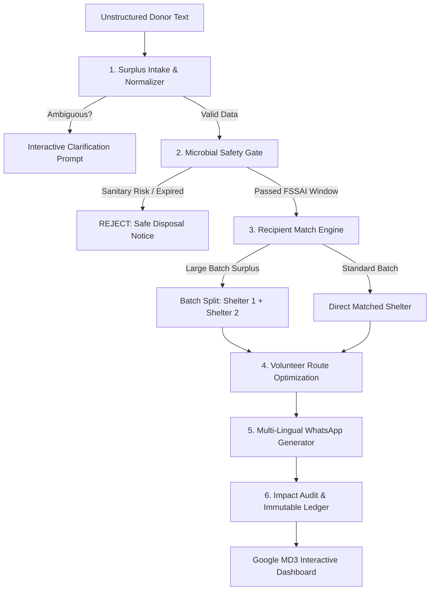

# 🌾 AnnaSetu (Zero Food Waste)
> **Autonomous Hyperlocal Surplus Meal Rescue & Redistribution Engine for Bhubaneswar, India**

[](https://nodejs.org/)
[](https://www.python.org/)
[](https://m3.material.io/)
[-7EBC6F?logo=openstreetmap&logoColor=white)](https://www.openstreetmap.org/)
[](https://opensource.org/licenses/MIT)

AnnaSetu is an autonomous, production-grade food rescue system designed for urban hyper-density in **Bhubaneswar, Odisha**. It ingests unstructured surplus food listings (from banquets, temples, corporate cafeterias, and restaurants) and executes an end-to-end redistribution pipeline in **under 50 milliseconds**.

---

## ⚡ Quickstart (Run in 2 Steps)

### Prerequisites
- **Node.js** (v18 or higher)
- **Python** (v3.10 or higher)

### 1. Install & Launch
Clone the repository and run:

```bash
# 1. Clone repository
git clone https://github.com/terminal-killer/Zero_food_waste.git
cd Zero_food_waste

# 2. Install dependencies & start
npm install
npm start
```

### 2. Open the Dashboard
Visit [**http://localhost:3000/dashboard**](http://localhost:3000/dashboard) in your browser.

> 💡 **Zero API Key Required:** AnnaSetu operates completely offline/locally with deterministic algorithms and OpenStreetMap tiles. No external paid API keys or signups needed.

---

## 🧪 Run Automated Tests

Verify all 6 Bhubaneswar test scenarios (including batch splits, sanitary rejections, and donor clarification):

```bash
npm test
```

Or run the Python pipeline test suite directly:

```bash
python tests/test_all_samples.py
```

---

## 🚀 Key Features

1. **Intelligent Surplus Ingestion (`surplus-intake`)**
   - Parses unstructured natural language, quantities, food items, and cooked/expiry timestamps.
   - Fuzzy-matches against 40+ Bhubaneswar localities (Patia, Saheed Nagar, Old Town, Nayapalli, etc.).
   - If critical information (quantity/location) is missing, triggers an interactive **clarifying question**.

2. **Microbial Food Safety Gate (`food-safety-check`)**
   - Strict FSSAI-aligned biological growth limits based on dish risk tier (rice, dal, gravy, dairy, sweets).
   - Automatically **rejects** contaminated buffet leftovers or expired trays.
   - Calculates exact safe consumption cutoff and transit time buffer.

3. **Hyperlocal Recipient Matching (`match-recipients`)**
   - Matches surplus food to vetted beneficiary shelters (orphanages, elder care, slum kitchens, night shelters).
   - **Automated Batch Splitting:** If surplus exceeds shelter capacity, splits meals intelligently across multiple nearby recipients.

4. **Volunteer Route Optimization (`pickup-plan`)**
   - Computes shortest ETA paths linking donors, nearby volunteers, and dropoff shelters.
   - Verified deliverability window check to ensure food arrives hot and safe.

5. **Multilingual Alert Dispatch (`notify-message`)**
   - Generates ready-to-dispatch WhatsApp messages formatted in **English, Odia (ଓଡ଼ିଆ), and Hindi (हिन्दी)** for donors, volunteers, and shelters.

6. **Immutable Impact Audit Ledger (`impact-report`)**
   - Quantifies meals saved, kilograms of food diverted from landfills, CO₂e emissions prevented, and economic value preserved in INR.

---

## 🗺️ Live System Architecture



---

## 📁 Repository Structure

```
Zero_food_waste/
├── data/
│   ├── areas.csv            # 40+ Bhubaneswar localities with coordinates
│   ├── recipients.csv       # Vetted shelters, orphanages, and community kitchens
│   ├── volunteers.csv       # Active volunteer fleet with vehicle types
│   ├── ledger.csv           # Immutable audit log of all completed dispatches
│   └── sample_listings.txt  # Test cases & real-world scenarios
├── public/
│   ├── dashboard.html       # Google Material Design 3 Light Mode Dashboard
│   ├── css/                 # Styling & UI tokens
│   └── js/                  # Client-side map & state scripts
├── skills/
│   ├── surplus-intake/      # Natural language & time parser
│   ├── food-safety-check/   # FSSAI biological safety rules
│   ├── match-recipients/    # Proximity & capacity matching + batch splitter
│   ├── pickup-plan/         # Route & travel duration calculator
│   ├── notify-message/      # Multilingual WhatsApp templates
│   ├── impact-report/       # Environmental & economic metrics
│   └── annasetu-orchestrator/# Fast sub-50ms Python orchestrator
├── tests/
│   ├── api.test.js          # REST API integration tests
│   └── test_all_samples.py  # Python multi-scenario test suite
├── server.js                # Express backend & API endpoints
└── package.json             # Scripts & dependencies
```

---

## 🔌 REST API Endpoints

| Method | Endpoint | Description |
| :--- | :--- | :--- |
| `POST` | `/api/annasetu/run` | Execute end-to-end pipeline on any surplus text |
| `POST` | `/api/annasetu/run/:id/answer` | Submit clarifying answer and resume mission |
| `GET` | `/api/annasetu/stats` | Aggregated live metrics from ledger (meals, CO₂e, INR) |
| `GET` | `/api/annasetu/runs` | Feed of the last 20 verified missions |
| `GET` | `/api/health` | Service health & active skills status |

---

## 📜 License

MIT License © 2026 IdeaSprint / AnnaSetu Team
